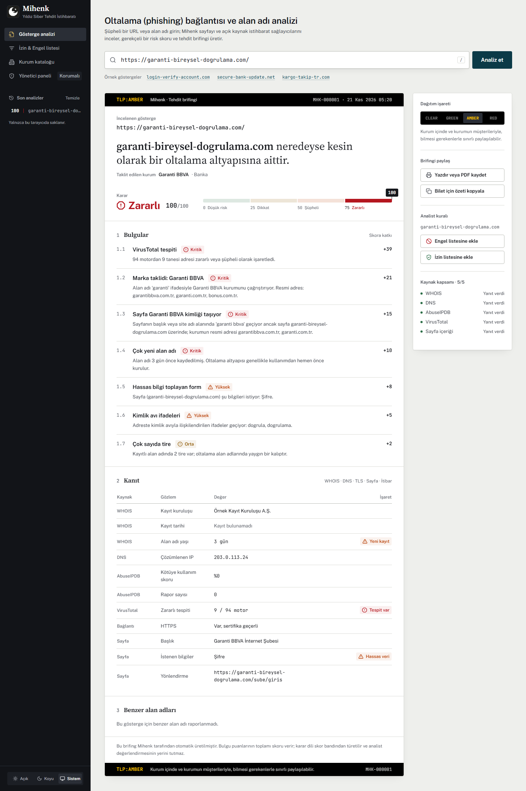
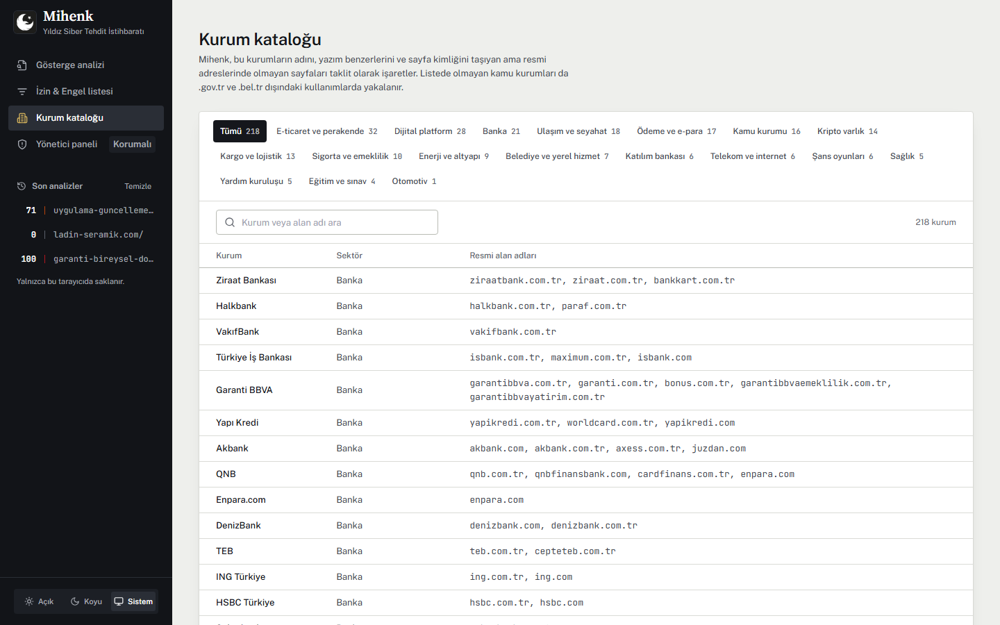
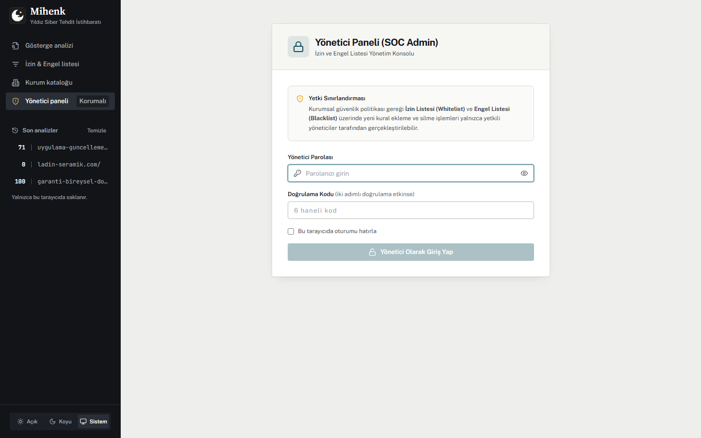
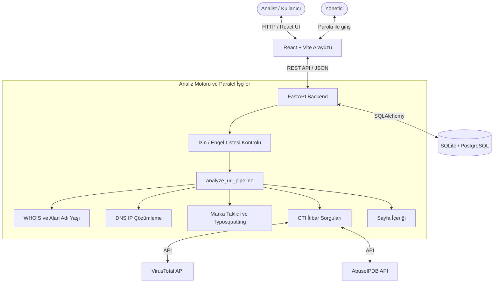

# Mihenk: Phishing Campaign Intelligence Platform


**Mihenk**, şüpheli URL ve alan adlarını (IOC - Indicator of Compromise) gerçek zamanlı olarak analiz eden, tehdit skorlaması yapan ve gerekçelendirilmiş siber tehdit istihbaratı (CTI) brifingleri üreten bir güvenlik platformudur.

---

## Ekran Görüntüleri

### Gösterge analizi: tehdit brifingi



> `https://kucoins-signin.com/` adresinin analizi: 99/100 skorla **Zararlı** kararı, KuCoin marka taklidi, VirusTotal tespiti, genç alan adı gibi bulgular, kaynak bazında kanıt tablosu ve TLP dağıtım işareti.

### Gösterge analizi: başlangıç ekranı


### İzin & Engel listesi


> Listeler herkes tarafından görüntülenebilir; kural ekleme ve silme yalnızca yönetici girişiyle yapılabilir.

### Kurum kataloğu



### Yönetici paneli

| Giriş | Yönetim konsolu |
| :---: | :---: |
|  |  |

---

## Öne Çıkan Özellikler

- **Açıklanabilir Tehdit Skoru (0 - 100):** WHOIS verileri, alan adı yaşı, TLD riskleri, şüpheli anahtar kelimeler ve itibar sorgularıyla hesaplanan skor. Her bulgu, skora kaç puan kattığıyla birlikte gösterilir. Kararlar: `Zararlı`, `Şüpheli`, `Dikkat`, `Düşük risk`.
- **Marka Taklidi ve Typosquatting Tespiti:** Banka, kripto borsa, e-ticaret, kamu kurumu gibi 218 kurumu içeren katalog üzerinden, kurum adını veya yazım benzerlerini taşıyan ama resmi adreste olmayan sayfaların tespiti.
- **İzin & Engel Listeleri:** Engel listesindeki bir kalıpla eşleşen gösterge harici sorgu beklenmeden Kritik (100) olarak değerlendirilir; izin listesindeki kalıplar harici sorgular atlanarak İzinli işaretlenir.
- **Yönetici Paneli:** Liste kurallarının eklenmesi ve silinmesi yalnızca yönetici girişiyle yapılabilir. Panel ayrıca kural ve analiz sayılarını gösterir.
- **Harici CTI Servis Entegrasyonları:**
  - **VirusTotal API:** Zararlı tespit analizleri.
  - **AbuseIPDB API:** IP adresi itibarı ve kötüye kullanım raporları.
  - **WHOIS ve DNS:** Kayıt tarihi, alan adı yaşı ve çözümlenen IP.
  - **Sayfa içeriği:** Şüpheli sayfa JavaScript çalıştırılmadan indirilip incelenir (`PAGE_FETCH_ENABLED`). Yönlendirmeler (HTTP, `Refresh`, 60 saniyeye kadar gecikmeli) ve gömülü belgeler (`iframe`, `frame`, `object`, `embed`, `srcdoc`) izlenir.
  - **İnceleme kapsamı ve “Karar verilemedi”:** Mihenk bir tarayıcı değildir. Statik incelemenin göremediği bir yapı (betik, incelenemeyen çerçeve, boyut sınırında kesilen yanıt, XML tanımları, izlenmeyen yönlendirme) varsa ya da sayfa indirilemediyse `inspection_coverage` alanı `partial`/`none` olur ve `inspection_gaps` nedeni listeler. Bu durumda düşük skor **“Düşük risk” değil “Karar verilemedi” (`risk_level: UNKNOWN`)** olarak döner; karar sunucuda üretilir ve kayda da böyle yazılır. İstisna: katalogdaki bir kurumun resmi adresi. Betik içeren sitelerin çoğu bu yüzden “Karar verilemedi” görünür; bu bilinçli bir tercihtir (bkz. `rapor/` 6. rapor, 7.1).
  - **Sayfa nasıl ayrıştırılır (7. rapor):** Sayfa incelemesi tarayıcıyı ev yapımı kodla taklit etmez; standart uyumlu kitaplıklar kullanır: HTML için WHATWG ağaç kurucu (Lexbor / `selectolax`, betik açık tarayıcı gibi), sayfadan gelen adresler için WHATWG URL (`ada-url`; `<base href>` ve `formaction` dahil), kodlama etiketleri için WHATWG Encoding tablosu (`webencodings`). Ayrıştırma, ayarları ve sırları görmeyen, süre sınırlı ayrı bir **işçi süreçte** yapılır (`backend/sandbox/`); süre sınırını aşan belge “incelenemedi” olur.
  - **Statik incelemenin sınırları ve “Düşük risk” ne demek değildir:** Betik çalıştırılmaz, stil sayfaları uygulanmaz, görseller okunmaz. Bu yüzden: XML türündeki belgeler (XHTML/SVG), tanınmayan ya da çok baytlı kodlamalar, kaynağında form olup ayrıştırılan belgede olmayan sayfalar ve hassas bilgi isteyip kurum kimliği metinden belirlenemeyen formlar **`partial`** sayılır. Kısıtlı uzantılar (`k12.tr`, `bel.tr`, `edu.tr` …) yalnızca sayfa incelenebildiğinde güven sinyalidir. “Düşük risk”, sayfanın zararsız olduğunu değil, statik incelemede gösterge bulunmadığını söyler; sunucu Mihenk'e farklı içerik gösterebilir (gizlenme).
  - **Analiz sırasında ne ziyaret edilir:** Mihenk sorulan adresi, yönlendirmelerini ve sayfanın gösterdiği çerçeveleri indirir. Sayfa başka bir kurumun kimliğini taşıyorsa, sayfadaki bağlantıları da ziyaret eder (en fazla üç tanesini; iki sayfalı oltalama kitlerinde form ikinci sayfadadır). Kimlik taşımayan sayfanın bağlantılarına ve belirteç (`token`, `key`, uzun rastgele değer) taşıyan bağlantılara dokunulmaz; analiz başına gömülü belge ve bağlantı isteği sayısı sınırlıdır. Yine de tek kullanımlık bir bağlantıyı (parola sıfırlama, onay) analiz ettirmek o bağlantıyı tüketebilir.
  - **Kimliği belirlenemeyen giriş formu:** Parola, kart ya da T.C. kimlik numarası isteyen ve hangi kuruma ait olduğu belirlenemeyen sayfa — kısıtlı uzantıda (`k12.tr`, `bel.tr` …) olsa da — “Düşük risk” değil **“Karar verilemedi”** alır. Katalogda olmayan sitelerin kendi giriş sayfaları da bu kararı alır; bu bilinçli bir tercihtir (8. rapor, G-07).
  - **Ayrıştırma işçileri:** Sayfalar üç işçi süreçte ayrıştırılır; arka uç konteynerinin bellek sınırı (1 GiB) bu işçileri kapsar. Bir analiz isteğinin toplam ayrıştırma süresi ve yakın zamanda zaman aşımı üreten istemcinin kullanabileceği işçi sayısı sınırlıdır.
  - **Veri toplayan form:** Alan türü tanınmasa da (etiket görselle ya da listede olmayan bir sözcükle yazılmış olabilir) metin girdisini `POST` ile ya da başka bir alan adına gönderen ve kimliği belirlenemeyen form **“Karar verilemedi”** sonucunu alır. Bilinçli bir tercihtir: betiksiz iletişim ve üyelik formları da bu sonucu alır.
  - **Beklenmeyen yönlendirme:** Gecikmeli `refresh` en fazla 2 saniye beklenir; daha uzun gecikme, 10–60 saniyelik kendine yenileme ve farklı hedef gösteren birden fazla `refresh` etiketi “tam incelendi” sayılmaz.
  - **Ayrıştırılamayan sayfa:** Ayrıştırıcının süre ya da derinlik sınırına takılan sayfada ham metindeki kurum adı ve parola alanı yine değerlendirilir; kapsam “kısmi” kalır.
  - **Zayıf kanıt:** Logo/başlıktaki üç–beş harfli kısaltma (ING, PTT; ama “UPS Sistemleri” de) tek başına “taklit” hükmü vermez; “Şüpheli” düzeyinde ayrı bir bulgudur.
  - **Alt kaynaklar:** Form taşıyan sayfanın stil sayfaları (en fazla 2) indirilip sayfayla birlikte incelenir; yönlendiren ara sayfanın ilk görseli istenir. Kurum adını ya da alan etiketini harici stil sayfasıyla yazmak ve “görsel istenmediyse tarayıcı değildir” gizlenmesi bu yolla karşılanır.
  - **Görselle anlatılan sayfa:** Neredeyse hiç metni olmayan, görsel ve bir-üç bağlantıdan oluşan sayfa “tam incelendi” sayılmaz. Birden fazla `refresh` etiketinde Chromium'un izlediği etiket izlenir (Chromium 156 ile ölçüldü).
  - **Engel listesi** yalnızca girilen adrese değil, yönlendirme zincirindeki her adıma, son adrese ve sayfanın gösterdiği çerçevelere uygulanır.
- **Eşzamanlı Analiz Hattı:** `ThreadPoolExecutor` ile WHOIS, DNS çözümleme ve itibar sorguları paralel yürütülür.
- **Paylaşılabilir Brifing:** TLP dağıtım işareti (CLEAR / GREEN / AMBER / RED), yazdırma ve PDF kaydetme, bilet için özet kopyalama.
- **Açık / Koyu / Sistem teması** ve tarayıcıda saklanan son analizler listesi.

---

## Teknoloji Yığını

| Katman | Teknoloji / Kütüphane | Açıklama |
| :--- | :--- | :--- |
| **Backend** | Python 3.11, FastAPI, Uvicorn | Yüksek performanslı REST API servisi |
| **Frontend** | React 18, Vite, TailwindCSS | Açık ve koyu temalı analist arayüzü |
| **Veritabanı** | SQLite / PostgreSQL | Geliştirmede hafif SQLite, Docker üzerinde PostgreSQL |
| **ORM ve Doğrulama** | SQLAlchemy 2.0, Pydantic v2 | Veritabanı modeli yönetimi ve şema doğrulamaları |
| **Kapsayıcı** | Docker ve Docker Compose | Multi-stage build ile optimize edilmiş konteynerizasyon |

---

## Sistem Mimarisi



---

## Kurulum ve Çalıştırma

Projeyi çalıştırmak için **iki farklı yöntem** bulunmaktadır.

### Yöntem 1: Docker Compose ile Çalıştırma (Önerilen)

Bilgisayarınızda [Docker Desktop](https://www.docker.com/products/docker-desktop/) kuruluysa tek komutla tüm servisleri ayağa kaldırabilirsiniz.

1. Proje dizinine gidin ve `.env` dosyasını hazırlayın:
   ```bash
   cd Mihenk
   cp .env.example .env
   ```

2. `.env` içindeki gizli değerleri **doldurun**. Örnek dosyada parola yoktur; boş bırakılırsa servisler başlamaz.
   ```bash
   # Veritabanı parolası
   py -3.11 -c "import secrets; print(secrets.token_urlsafe(32))"
   # Yönetici parolasının özeti (çıktı satırı ADMIN_PASSWORD_HASH='...' biçimindedir; .env'e olduğu gibi yapıştırın)
   py -3.11 -m backend.hash_password
   ```

3. Konteynerleri derleyin ve başlatın:
   ```bash
   docker compose up --build
   ```

4. Ayarların uygulandığını doğrulayın. Compose, `.env` dosyasının **tamamını** arka uca verir
   (`env_file`); arka uç açılışta fiili durumu tek satırda kayda yazar:
   ```bash
   docker compose logs backend | grep "security state"
   # ... security state second_factor=on trusted_networks=1 restrict_to_trusted=on login_max_failures=5 ...
   ```
   Aynı bilgi yönetici panelinin üstünde de görünür; ikinci etken kapalıyken panelde kalıcı bir uyarı vardır.

Servisler hazır olduğunda arayüz ve API tek adresten, HTTPS ile sunulur: **https://localhost**
(`localhost` için Caddy yerel bir sertifika üretir; tarayıcı ilk seferde uyarı verebilir. `SITE_ADDRESS`
değişkenine gerçek bir alan adı yazılırsa geçerli sertifika otomatik alınır.)

Veritabanı ve arka uç yalnızca Compose iç ağında çalışır; ana makineye port açılmaz.

---

### Yöntem 2: Yerel Ortamda Manuel Çalıştırma (Python + Node.js)

#### 1. Backend (FastAPI)

```bash
# 1. Proje klasörüne gidin
cd Mihenk

# 2. .env dosyasını oluşturun ve ADMIN_PASSWORD_HASH (veya en az 12 karakterli ADMIN_PASSWORD) yazın
cp .env.example .env

# 3. Python sanal ortamı oluşturun ve aktif edin
py -3.11 -m venv venv
# Windows için:
.env\Scriptsctivate
# Linux/macOS için:
source venv/bin/activate

# 4. Sabitlenmiş bağımlılıkları yükleyin
pip install --require-hashes -r backend/requirements.txt

# 5. FastAPI sunucusunu başlatın (yalnızca bu makineden erişilebilir)
python -m uvicorn backend.main:app --host 127.0.0.1 --port 8000
```

Düz HTTP ile `http://localhost` dışındaki bir adresten geliştirme yapıyorsanız `.env` içinde
`COOKIE_SECURE=false` ayarlayın; aksi halde tarayıcı oturum çerezini göndermez.

#### 2. Frontend (React + Vite)

Yeni bir terminal penceresinde:

```bash
cd Mihenk
npm ci
npm run dev
```

Vite geliştirme sunucusu yalnızca `127.0.0.1:5173` üzerinde dinler ve API isteklerini arka uca
vekiller (aynı köken; CORS gerekmez). Geliştirme sunucusu dağıtımda kullanılmaz: üretimde arayüz
`npm run build` ile derlenir ve arka uç tarafından sunulur.

#### Testler

```bash
py -3.11 -m pytest backend/tests -q

# Aynı testler üretim imajının yorumlayıcısı ve kitaplıklarıyla (CI'da da böyle çalışır):
docker build -f backend/Dockerfile -t mihenk-backend:ci .
docker run --rm -v "${PWD}:/src:ro" -w /src mihenk-backend:ci sh -c "pip install -q --target /tmp/dev --require-hashes -r backend/requirements-dev.txt && PYTHONPATH=/tmp/dev python -m pytest backend/tests -q -p no:cacheprovider"
```

---

## Ortam Değişkenleri (.env)

Tüm değişkenler ve açıklamaları `.env.example` dosyasındadır. Docker Compose bu dosyanın tamamını arka
uca aktarır; `docker-compose.yml` içindeki `environment` bölümünde yalnızca Compose'un ürettiği veya
sabitlediği değerler (`DATABASE_URL`, `COOKIE_SECURE`, `FORWARDED_ALLOW_IPS`) bulunur. Güvenlikle ilgili olanlar:

| Değişken | Açıklama |
| :--- | :--- |
| `ADMIN_PASSWORD_HASH` | Yönetici parolasının scrypt özeti (`py -3.11 -m backend.hash_password`). Önerilen yöntem. |
| `ADMIN_PASSWORD` | Alternatif, yalnızca yerel geliştirme. En az 12 karakter; bilinen örnek değerler reddedilir. |
| `POSTGRES_PASSWORD` | Compose veritabanı parolası. Tanımsızsa Compose çalışmaz. |
| `ADMIN_SESSION_TTL_MINUTES` | Yönetici oturum süresi (varsayılan 480). |
| `COOKIE_SECURE` | Oturum çerezi yalnızca HTTPS'te gönderilir (varsayılan `true`). |
| `PUBLIC_BASE_URL` | Sitenin herkese açık adresi (SEO). Boşsa bütün sayfalar `noindex` olur; bkz. “Arama Motoru Görünürlüğü”. |
| `LOGIN_MAX_FAILURES` / `LOGIN_WINDOW_SECONDS` | IP başına hatalı giriş sınırı (varsayılan 15 dakikada 5). |
| `LOGIN_GLOBAL_MAX_FAILURES` / `LOGIN_GLOBAL_DELAY_SECONDS` | Tüm istemciler için saatlik hatalı giriş eşiği. Aşılınca giriş **reddedilmez**, yavaşlatılır ve `ALERT` kaydı üretilir; doğru parola başkalarının hataları yüzünden hiçbir zaman reddedilmez. |
| `ADMIN_TOTP_SECRET` | İkinci etken (TOTP, 6 haneli kod). `py -3.11 -m backend.totp_secret` ile üretin. Önerilir. |
| `ADMIN_TRUSTED_NETWORKS` / `ADMIN_RESTRICT_TO_TRUSTED` | Yönetici için güvenilen CIDR aralıkları; istenirse yönetici paneli yalnızca bu aralıklardan kullanılabilir. |
| `IOC_MAX_ROWS` | Toplam gösterge sayısı üst sınırı (varsayılan 200.000); aşılınca kampanyaya bağlı olmayan en eski kayıtlar silinir. |
| `ANALYZE_RATE_PER_MINUTE` / `ANALYZE_MAX_CONCURRENT` | Analiz hız ve eşzamanlılık sınırı. |
| `ANALYSIS_DNS_1` / `ANALYSIS_DNS_2` | Compose: analiz edilen adların çözümleneceği genel DNS sunucuları (varsayılan 1.1.1.1, 9.9.9.9). Var olmayan adlara yanıt uyduran veya iç adları bilen çözümleyici kullanmayın. |
| `CORS_ORIGINS` | Arayüz farklı kökendeyse virgülle ayrılmış kökenler. Joker (`*`) kabul edilmez. |
| `ENABLE_API_DOCS` | `/docs`, `/redoc`, `/openapi.json` (varsayılan kapalı). |

Gizli değerler yalnızca ortam değişkeninden okunur; kodda varsayılan parola veya anahtar yoktur.

**Güven verileri.** "Resmi alan adı" kararı `backend/data/tr_brands.json` içindeki `domains` listesine göre
verilir. Herkesin içerik yayımlayabildiği alanlar (blog, bulut depolama, form, kısa bağlantı) bu listeye
**eklenmez**; kurumun bu tür alanları `user_content_domains` altında tutulur. Herkesin alt alan adı açabildiği
sonekler Public Suffix List (`backend/data/public_suffix_list.dat`) ve `backend/core/suffixes.py` ile
belirlenir. PSL'yi güncellemek için dosyayı https://publicsuffix.org/list/public_suffix_list.dat adresinden
yeniden indirin; test paketi katalog ile sonek listesinin tutarlılığını denetler.

**Ağ notu.** İstemci başına sınırlar kaynak IP'ye göredir. Docker Desktop'ta ve Docker'ın kullanıcı alanı
vekilinden geçen bağlantılarda tüm istemciler tek adresten geliyor görünebilir; üretimde arka uç kayıtlarında
gerçek istemci adreslerinin göründüğünü doğrulayın.

---

## Arama Motoru Görünürlüğü (SEO)

Mihenk tek sayfalı bir uygulamadır; arama motorları ve yapay zekâ tarayıcıları için gereken her şey **sunucunun döndürdüğü ilk HTML'de** bulunur (JavaScript beklenmez).

| Konu | Davranış |
|---|---|
| **Dizine eklenme** | `PUBLIC_BASE_URL` tanımlıysa ana sayfa dizine açılır. **Boşsa** (yerel, iç ağ, deneme kurulumu) bütün sayfalar `noindex` olur ve `robots.txt` taramayı kapatır. |
| **İlk HTML içeriği** | `index.html` içinde tek `<h1>`, “Nasıl çalışır?”, “Neleri denetler?” ve sık sorulan sorular bulunur; uygulama yüklenince React bu içeriğin yerini alır. |
| **Başlık etiketleri** | Açıklayıcı `<title>` ve `meta description`, Open Graph / Twitter kartı, `canonical`, `robots` (sunucuda eklenir: `backend/core/seo.py`). |
| **Yapılandırılmış veri** | JSON-LD `WebSite` + `WebApplication`. Doğrulanamayan puan/yorum alanı üretilmez. `FAQPage` işaretlemesi eklenmedi: Google SSS zengin sonuçlarını Mayıs 2026'da kaldırdı. |
| **`/robots.txt`** | Ana sayfa taranabilir; API uç noktaları (`/analyze`, `/ioc`, `/campaign`, `/lists`, `/brands`, `/admin`) taranmaz. Site haritası adresi bildirilir. |
| **`/sitemap.xml`**, **`/llms.txt`** | Yalnızca `PUBLIC_BASE_URL` tanımlıyken yayımlanır. `llms.txt` Google Arama tarafından kullanılmaz; bazı yapay zekâ araçları okur. |
| **API yanıtları** | Her koşulda `X-Robots-Tag: noindex, nofollow` taşır: analiz sonuçları ve kayıtlar dizine girmez. |
| **Gerçek 404** | Bilinmeyen yol artık ana sayfayı 200 ile döndürmez (“soft 404”); `404` ve `noindex` döner. |
| **Önbellek** | `/assets/*` (içerik özetli dosya adları) `immutable`, bir yıl; `index.html` `no-cache`. |
| **Mutlak adresler** | Yalnızca `PUBLIC_BASE_URL` değerinden üretilir; isteğin `Host` başlığı kullanılmaz. |

Yapay zekâ tarayıcıları (GPTBot, PerplexityBot, CCBot …) varsayılan olarak engellenmez. Engellemek isterseniz `backend/core/seo.py` içindeki `robots_txt()` işlevine ilgili `User-agent` / `Disallow: /` satırlarını ekleyin.

Yayına aldıktan sonra: `PUBLIC_BASE_URL` değerini ayarlayın, Google Search Console ve Bing Webmaster Tools'a site haritasını (`/sitemap.xml`) gönderin, paylaşım görselini (`public/og-image.png`, 810×540) isterseniz 1200×630 bir görselle değiştirin.


## API Uç Noktaları (Endpoints)

| Yöntem | Endpoint | Yetki | Açıklama |
| :--- | :--- | :--- | :--- |
| `POST` | `/analyze/url` | Herkese açık, hız sınırlı | Verilen URL için tam CTI analizi ve risk skorlaması yapar |
| `GET` | `/brands` | Herkese açık | Taklit tespitinde kullanılan kurum kataloğunu döner |
| `GET` | `/health` | Herkese açık | Servis sağlık durumunu kontrol eder |
| `GET` | `/ioc/{ioc_id}` | Yönetici | Tek bir IOC kaydını ve son analiz sonucunu getirir |
| `GET` | `/ioc/{ioc_id}/related` | Yönetici | IOC ile ilişkili benzer alan adlarını listeler |
| `GET` | `/campaign/{campaign_id}` | Yönetici | Kampanya detayları; kayıt yoksa 404 |
| `GET` | `/lists` | Yönetici | İzin ve engel listesi kuralları (`?list_type=whitelist\|blacklist`) |
| `POST` | `/lists` | Yönetici | Yeni kural ekler |
| `DELETE` | `/lists/{item_id}` | Yönetici | Kuralı siler |
| `POST` | `/admin/login` | — | Yönetici girişi; IP başına deneme sınırlı |
| `POST` | `/admin/logout` | — | Oturumu sunucuda geçersiz kılar |
| `GET` | `/admin/verify` | Yönetici | Yönetici oturumunu doğrular |
| `GET` | `/admin/stats` | Yönetici | Platform istatistiklerini döner |

Yönetici oturumu, başarılı girişte üretilen rastgele ve süreli bir anahtardır; tarayıcıda
`HttpOnly; Secure; SameSite=Strict` çerezde taşınır ve çıkışta sunucuda silinir. Oturumlar süreç
belleğinde tutulduğu için arka uç tek süreç (`--workers 1`) ile çalıştırılmalıdır; sunucu yeniden
başladığında yöneticinin tekrar giriş yapması gerekir.

Analiz uç noktası yalnızca herkese açık `http`/`https` adreslerini kabul eder: girdi tarayıcıyla
aynı kurallarla (WHATWG URL) kanonik hale getirilir; iç ağ, loopback, link-local ve özel kullanımlı
adreslere çözümlenen hedefler `400` ile reddedilir. Tüm dış bağlantılar (TLS yoklaması, sayfa
indirme) bir kez doğrulanan IP adresine sabitlenir.

---

## Proje Dizin Yapısı

```
Phishing-Campaign-Intelligence-Platform/
├── backend/                  # FastAPI arka plan servisleri
│   ├── api/                  # API rotaları (analyze, ioc, campaign, lists, brands, admin)
│   ├── core/                 # Analiz motoru (WHOIS, itibar, skorlama, sayfa içeriği, sonekler)
│   ├── data/                 # Kurum kataloğu (tr_brands.json) ve Public Suffix List
│   ├── models/               # SQLAlchemy veritabanı modelleri ve bağlantı
│   ├── schemas/              # Pydantic veri doğrulama şemaları
│   ├── tests/                # Backend testleri
│   ├── config.py             # Ayarlar ve ortam değişkenleri
│   └── main.py               # FastAPI uygulama giriş noktası
├── src/                      # React frontend uygulaması
│   ├── api/                  # Backend API istemcisi
│   ├── components/           # Arayüz bileşenleri (brief, layout, ui)
│   ├── lib/                  # Yardımcılar (tema, yönlendirme, TLP, karar)
│   ├── pages/                # Sayfalar (Analiz, Kurallar, Katalog, Yönetici)
│   ├── App.jsx               # Ana uygulama
│   └── index.css             # TailwindCSS stilleri
├── docs/
│   └── screenshots/          # README ekran görüntüleri
├── .env.example              # Örnek ortam değişkenleri dosyası
├── deploy/Caddyfile          # TLS sonlandıran ters vekil yapılandırması
├── docker-compose.yml        # Çoklu konteyner (DB + Backend + TLS vekili)
├── package.json              # Node.js bağımlılıkları ve komutları
└── README.md                 # Proje dokümantasyonu
```

---

## Lisans

Bu proje MIT Lisansı altında lisanslanmıştır. Güvenlik araştırmaları ve eğitim amaçlı kullanıma uygundur.
