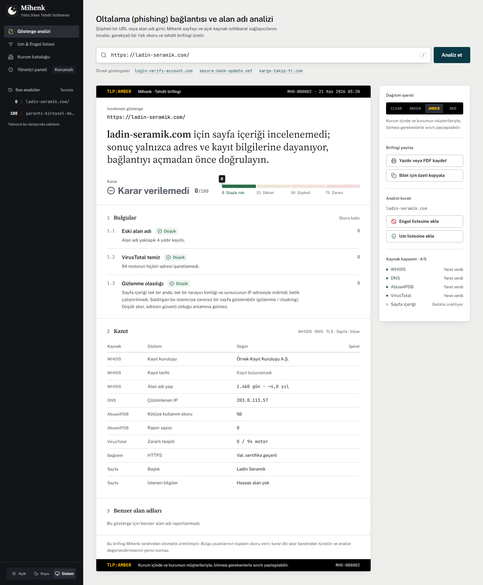
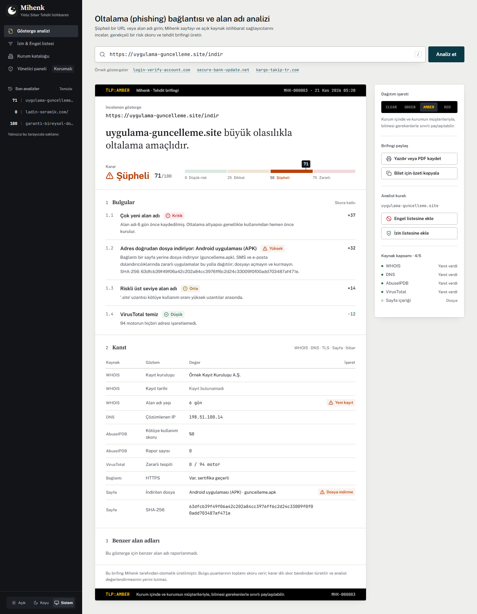
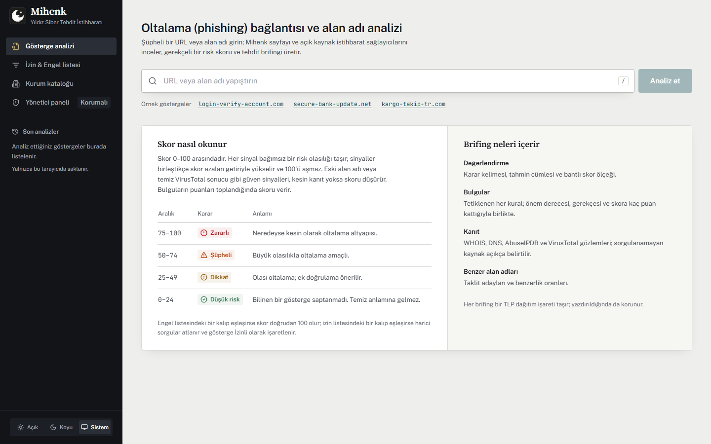
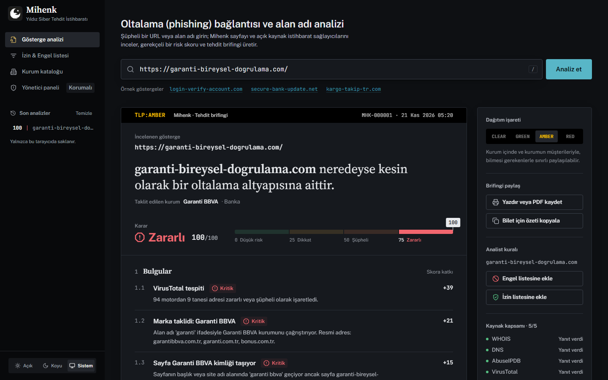
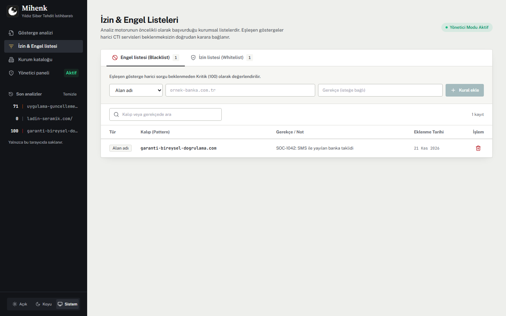
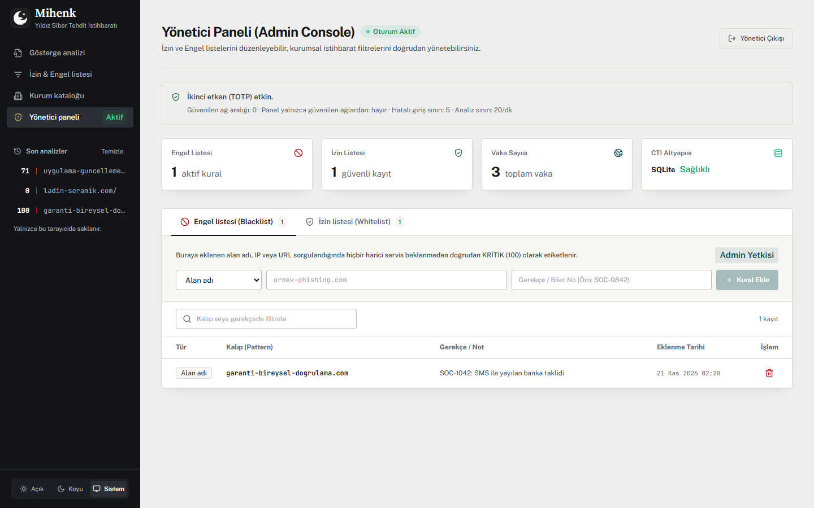
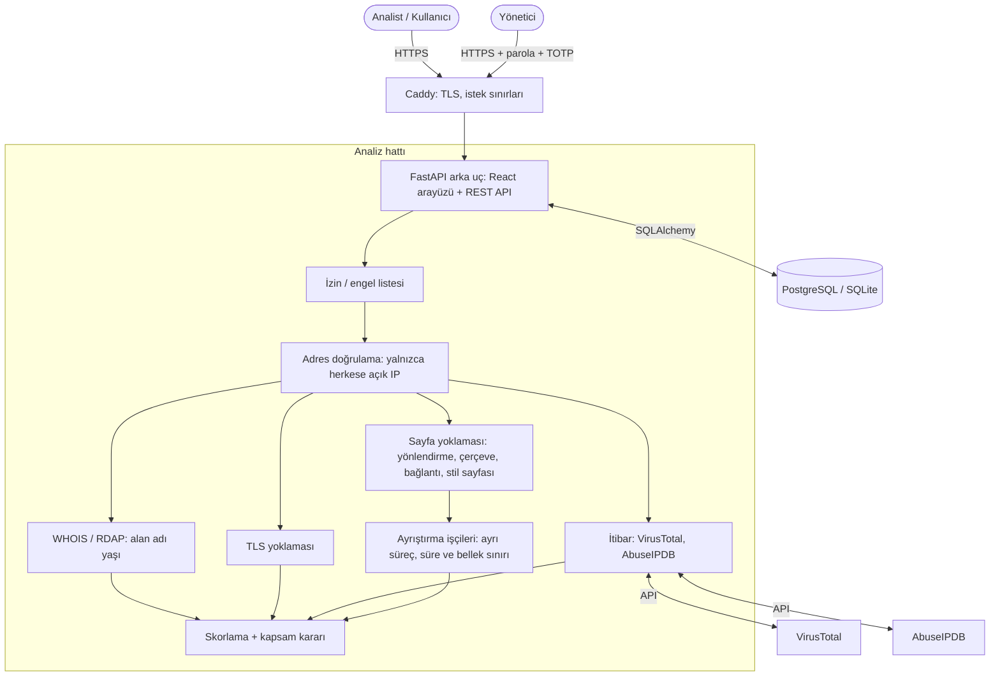

# Mihenk: Oltalama (Phishing) Tehdit İstihbaratı Platformu


**Mihenk**, şüpheli URL ve alan adlarını (IOC, *Indicator of Compromise*) analiz eden, açıklanabilir bir tehdit
skoru hesaplayan ve gerekçelendirilmiş siber tehdit istihbaratı (CTI) brifingleri üreten bir güvenlik platformudur.
SMS, e-posta ya da sosyal medyayla gelen bir bağlantıyı açmadan yapıştırırsınız; Mihenk sayfayı sizin yerinize
indirir, taklit edilen kurumu, bilgi toplayan formları ve yönlendirme zincirini inceler ve her bulgunun skora
katkısını gösteren bir karar üretir.


---

## İçindekiler

- [v2'de neler değişti](#v2de-neler-değişti)
- [Ekran görüntüleri](#ekran-görüntüleri)
- [Öne çıkan özellikler](#öne-çıkan-özellikler)
- [Karar nasıl verilir](#karar-nasıl-verilir)
- [Teknoloji yığını](#teknoloji-yığını)
- [Sistem mimarisi](#sistem-mimarisi)
- [Kurulum ve çalıştırma](#kurulum-ve-çalıştırma)
- [Ortam değişkenleri](#ortam-değişkenleri-env)
- [Arama motoru görünürlüğü (SEO)](#arama-motoru-görünürlüğü-seo)
- [API uç noktaları](#api-uç-noktaları)
- [Güvenlik](#güvenlik)
- [Proje dizin yapısı](#proje-dizin-yapısı)
- [Lisans](#lisans)

---

## v2'de neler değişti

| Alan | v1 | v2 |
| :--- | :--- | :--- |
| **Karar** | Dört karar (Zararlı, Şüpheli, Dikkat, Düşük risk) | Beşinci karar **Karar verilemedi**: sayfa tam incelenemediyse düşük skor “Düşük risk” olarak gösterilmez |
| **Sayfa incelemesi** | Tek sayfa, basit ayrıştırma | Yönlendirme zinciri, çerçeveler, ara sayfalar, gecikmeli `refresh`, stil sayfaları; tarayıcı standartlarıyla (WHATWG) ayrıştırma, ayrı ve süre sınırlı işçi süreçlerde |
| **Kurum kimliği** | Başlıkta kurum adı | Başlık, logo, sayfa metni, düğme ve alan yazıları; benzer harf, ters yazım ve harf harf bölme gibi gizleme yöntemleri |
| **Bilgi toplayan form** | Şifre alanı | Şifre, kart, T.C. kimlik no ve tanınmayan alan türleri; kimliği belirlenemeyen form “Karar verilemedi” alır |
| **Dosya indiren adresler** | — | APK, çalıştırılabilir dosya ve arşiv tespiti; dosya adı ve SHA-256 özeti |
| **Yönetici paneli** | Yalnızca parola | İki adımlı doğrulama (TOTP), sunucu tarafı oturum, güvenilen ağ kısıtı ve güvenlik durumu kartı |
| **Kural listeleri** | Herkese açık görüntüleme | Görüntüleme ve düzenleme yalnızca yöneticiye açık |
| **Dağıtım** | Tek konteyner | Docker Compose: TLS sonlandıran vekil (Caddy) + arka uç + PostgreSQL; özetle sabitlenmiş imajlar ve bağımlılıklar |
| **SEO** | — | Sunucuda eklenen meta etiketleri, yapılandırılmış veri, `robots.txt`, `sitemap.xml`, `llms.txt`, gerçek 404 |
| **Testler** | 1 test dosyası | 11 test dosyası, 788 test; CI'da bağımlılık denetimi ve imaj taraması |

---

## Ekran Görüntüleri

> Görüntüler yerel bir demo kurulumundan alınmıştır. Alan adları kurgusaldır; dış servis yanıtları (WHOIS,
> VirusTotal, AbuseIPDB) örnek verilerdir.

### Tehdit brifingi: Zararlı


Kurgusal `https://garanti-bireysel-dogrulama.com/` adresinin analizi: adres bir ara sayfadan giriş sayfasına
yönlendiriyor; sayfa başlığında Garanti BBVA kimliği ve şifre formu bulunuyor. Brifing şunları içerir:

- **Karar ve skor:** karar kelimesi, tahmin cümlesi ve bantlı skor ölçeği
- **Bulgular:** tetiklenen her kural, önem derecesi, gerekçesi ve skora katkısı
- **Kanıt:** WHOIS, DNS, TLS, sayfa ve itibar gözlemleri; yönlendirme zinciri
- **Kaynak kapsamı:** hangi kaynağın yanıt verdiği, hangisinin sorgulanamadığı
- **Paylaşım:** TLP dağıtım işareti, yazdırma / PDF ve bilet için özet

### Karar verilemedi



Mihenk sayfayı JavaScript çalıştırmadan inceler. Betik içeren, görselle anlatılan ya da tam indirilemeyen bir
sayfada skor düşük olsa bile karar **“Düşük risk” değil “Karar verilemedi”** olur; kaynak kapsamında “Sayfa
içeriği” satırı nedenini gösterir.

### Dosya indiren adres



Bağlantı sayfa yerine doğrudan dosya indiriyorsa (APK, çalıştırılabilir dosya, arşiv) dosya türü, adı ve
SHA-256 özeti kanıt tablosuna eklenir.

### Başlangıç ekranı



### Koyu tema



Açık, koyu ve sistem teması desteklenir; seçim tarayıcıda saklanır.

### Kurum kataloğu


Taklit tespitinde kullanılan 218 kurum (banka, ödeme, kargo, e-ticaret, kamu, telekom …) ve resmi alan adları.

### İzin & engel listesi



Kural listeleri ve analist notları yalnızca yönetici girişiyle görüntülenir; kural ekleme ve silme de yöneticiye
aittir.

### Yönetici paneli

| Giriş | Yönetim konsolu |
| :---: | :---: |
|  |  |

Girişte parolaya ek olarak iki adımlı doğrulama kodu (TOTP) istenebilir. Konsolun üstündeki güvenlik durumu kartı,
ikinci etkenin, güvenilen ağ kısıtının ve giriş/analiz sınırlarının sunucuda gerçekten etkin olup olmadığını
gösterir; ikinci etken kapalıyken kart kalıcı bir uyarıya dönüşür.

---

## Öne Çıkan Özellikler

- **Açıklanabilir tehdit skoru (0–100):** Alan adı yaşı, uzantı riski, şüpheli ifadeler, marka taklidi, sayfa
  içeriği ve itibar sorgularından hesaplanır. Her bulgu skora kaç puan kattığıyla birlikte gösterilir.
- **Marka taklidi tespiti:** 218 kurumluk katalog üzerinden alan adında ve sayfa içeriğinde kurum adını ya da
  yazım benzerlerini (benzer harf, Punycode, sahte resmi uzantı) taşıyan ama resmi adreste olmayan sayfalar.
- **Sayfa içeriği incelemesi:** Sayfa JavaScript çalıştırılmadan, boyut ve süre sınırıyla indirilir. HTTP ve
  `refresh` yönlendirmeleri, gömülü belgeler (`iframe`, `frame`, `object`, `embed`, `srcdoc`), form tasarımı
  ve form hedefleri incelenir.
- **Bilgi toplayan form tespiti:** Şifre, kart bilgisi, T.C. kimlik numarası ve SMS kodu isteyen alanlar; alan
  etiketi görselle, benzer harfle ya da stil sayfasıyla yazılmış olsa da.
- **Dosya indiren adresler:** APK, Windows programı ve arşiv indiren bağlantılar; dosya özeti.
- **İzin ve engel listeleri:** Engel listesindeki bir kalıp, girilen adrese ve yönlendirme zincirindeki her
  adıma uygulanır; eşleşen gösterge 100 (Kritik) olur.
- **Harici CTI kaynakları:** VirusTotal (URL tespitleri), AbuseIPDB (IP itibarı), WHOIS/RDAP (kayıt tarihi), DNS.
  API anahtarı tanımlanmayan kaynak brifingde “sorgulanamadı” olarak belirtilir.
- **Paylaşılabilir brifing:** TLP dağıtım işareti (CLEAR / GREEN / AMBER / RED), yazdırma ve PDF, bilet özeti.
- **Arayüz:** Açık / koyu / sistem teması, tarayıcıda saklanan son analizler, klavye kısayolu (`/`).

---

## Karar nasıl verilir

| Skor | Karar | Anlamı |
| :--- | :--- | :--- |
| 75–100 | **Zararlı** | Neredeyse kesin olarak oltalama altyapısı |
| 50–74 | **Şüpheli** | Büyük olasılıkla oltalama amaçlı |
| 25–49 | **Dikkat** | Olası oltalama; ek doğrulama önerilir |
| 0–24 | **Düşük risk** | Sayfa tam incelendi ve gösterge bulunmadı |
| 0–24 | **Karar verilemedi** | Sayfa içeriği tam incelenemedi; sonuç yalnızca adres ve kayıt bilgilerine dayanıyor |

**“Düşük risk” bağlantının güvenli olduğu anlamına gelmez.** Mihenk bir tarayıcı değildir: betik çalıştırmaz,
görselleri okumaz ve sunucu ona farklı bir sayfa gösterebilir (gizlenme). Bu yüzden:

- Statik incelemenin göremediği bir yapı varsa (betik, incelenemeyen çerçeve, kesilen yanıt, beklenmeyen
  yönlendirme, ayrıştırılamayan belge) `inspection_coverage` alanı `partial` olur, `inspection_gaps` nedeni
  listeler ve düşük skor **“Karar verilemedi” (`risk_level: UNKNOWN`)** olarak döner. Karar sunucuda üretilir
  ve kayda da böyle yazılır.
- Şifre, kart ya da T.C. kimlik numarası isteyen (ya da metin girdisini gönderen) ve hangi kuruma ait olduğu
  belirlenemeyen form da “Karar verilemedi” alır. Katalogda olmayan sitelerin kendi giriş ve üyelik sayfaları da
  bu sonucu alır; bu bilinçli bir tercihtir.
- Yalnızca katalogdaki bir kurumun resmi adresi bu kuralların dışındadır.

**Analiz sırasında ne ziyaret edilir:** sorulan adres, yönlendirmeleri, sayfanın gösterdiği çerçeveler ve form
taşıyan sayfanın stil sayfaları. Sayfa başka bir kurumun kimliğini ya da tuzak ifadesi (“hesabınız kısıtlandı”)
taşıyorsa Mihenk sayfadaki bağlantıları da ziyaret eder (en fazla üç tanesini; iki sayfalı oltalama kitlerinde form ikinci sayfadadır).
Belirteç (`token`, `key`, uzun rastgele değer) taşıyan bağlantılara dokunulmaz; analiz başına istek sayısı
sınırlıdır. Yine de tek kullanımlık bir bağlantıyı (parola sıfırlama, onay) analiz ettirmek onu tüketebilir.

---

## Teknoloji Yığını

| Katman | Teknoloji / Kütüphane | Açıklama |
| :--- | :--- | :--- |
| **Arka uç** | Python 3.11, FastAPI, Uvicorn | REST API ve analiz hattı |
| **Sayfa ayrıştırma** | selectolax (Lexbor), ada-url, webencodings | Tarayıcı standartlarıyla (WHATWG) HTML, URL ve kodlama; ayrı işçi süreçlerde |
| **Ön yüz** | React 18, Vite 8, Tailwind CSS 3 | Açık ve koyu temalı analist arayüzü |
| **Veritabanı** | SQLite / PostgreSQL 16 | Geliştirmede SQLite, Docker Compose'da PostgreSQL |
| **ORM ve doğrulama** | SQLAlchemy 2, Pydantic 2 | Veri modeli ve şema doğrulama |
| **Dağıtım** | Docker Compose, Caddy | TLS sonlandıran ters vekil, çok aşamalı imaj |
| **CI** | GitHub Actions, pip-audit, npm audit, Trivy | Test, bağımlılık ve imaj güvenlik taraması |

---

## Sistem Mimarisi



---

## Kurulum ve Çalıştırma

### Yöntem 1: Docker Compose (önerilen)

[Docker Desktop](https://www.docker.com/products/docker-desktop/) kuruluysa tüm servisler tek komutla çalışır.

1. `.env` dosyasını hazırlayın:
   ```bash
   cd Mihenk
   cp .env.example .env
   ```

2. `.env` içindeki gizli değerleri doldurun. Örnek dosyada parola yoktur; boş bırakılırsa servisler başlamaz.
   ```bash
   # Veritabanı parolası
   py -3.11 -c "import secrets; print(secrets.token_urlsafe(32))"
   # Yönetici parolasının özeti (çıktı satırı ADMIN_PASSWORD_HASH='...' biçimindedir; .env'e olduğu gibi yapıştırın)
   py -3.11 -m backend.hash_password
   # İki adımlı doğrulama sırrı (önerilir; çıkan otpauth:// adresini doğrulayıcı uygulamaya ekleyin)
   py -3.11 -m backend.totp_secret
   ```

3. Konteynerleri derleyin ve başlatın:
   ```bash
   docker compose up --build
   ```

4. Ayarların uygulandığını doğrulayın. Arka uç açılışta fiili güvenlik durumunu tek satırda kayda yazar:
   ```bash
   docker compose logs backend | grep "security state"
   # ... security state second_factor=on trusted_networks=1 restrict_to_trusted=on login_max_failures=5 ...
   ```
   Aynı bilgi yönetici panelinin üstündeki güvenlik durumu kartında da görünür.

Arayüz ve API tek adresten, HTTPS ile sunulur: **https://localhost** (`localhost` için Caddy yerel bir sertifika
üretir; tarayıcı ilk seferde uyarı verebilir). `SITE_ADDRESS` değişkenine gerçek bir alan adı yazılırsa geçerli
sertifika otomatik alınır. Veritabanı ve arka uç yalnızca Compose iç ağında çalışır; ana makineye port açılmaz.
Doğrudan internete açılan kurulumlar için `deploy/README.md` dosyasındaki bağlantı sınırı notlarına bakın.

### Yöntem 2: Yerel ortamda (Python + Node.js)

**Arka uç**

```bash
cd Mihenk
cp .env.example .env          # ADMIN_PASSWORD_HASH (veya en az 12 karakterli ADMIN_PASSWORD) yazın

py -3.11 -m venv venv
venv\Scripts\activate         # Windows
source venv/bin/activate      # Linux / macOS

pip install --require-hashes -r backend/requirements.txt
python -m uvicorn backend.main:app --host 127.0.0.1 --port 8000
```

Düz HTTP ile `http://localhost` dışındaki bir adresten geliştirme yapıyorsanız `.env` içinde
`COOKIE_SECURE=false` ayarlayın; aksi halde tarayıcı oturum çerezini göndermez.

**Ön yüz** (yeni bir terminalde)

```bash
npm ci
npm run dev
```

Vite geliştirme sunucusu yalnızca `127.0.0.1:5173` üzerinde dinler ve API isteklerini arka uca vekiller (aynı
köken; CORS gerekmez). Üretimde arayüz `npm run build` ile derlenir ve arka uç tarafından sunulur.

### Testler

```bash
pip install --require-hashes -r backend/requirements-dev.txt
py -3.11 -m pytest backend/tests -q

# Aynı testler üretim imajının yorumlayıcısı ve kitaplıklarıyla (CI'da da böyle çalışır):
docker build -f backend/Dockerfile -t mihenk-backend:ci .
docker run --rm -v "${PWD}:/src:ro" -w /src mihenk-backend:ci sh -c "pip install -q --target /tmp/dev --require-hashes -r backend/requirements-dev.txt && PYTHONPATH=/tmp/dev python -m pytest backend/tests -q -p no:cacheprovider"
```

Test paketi ağ bağlantısı gerektirmez; dış sorgular ve sayfa indirme testlerde sahte yanıtlarla değiştirilir.

---

## Ortam Değişkenleri (.env)

Tüm değişkenler ve açıklamaları `.env.example` dosyasındadır. Docker Compose bu dosyanın tamamını arka uca
aktarır; `docker-compose.yml` içindeki `environment` bölümünde yalnızca Compose'un ürettiği veya sabitlediği
değerler (`DATABASE_URL`, `COOKIE_SECURE`, `FORWARDED_ALLOW_IPS`) bulunur.

| Değişken | Açıklama |
| :--- | :--- |
| `ADMIN_PASSWORD_HASH` | Yönetici parolasının scrypt özeti (`py -3.11 -m backend.hash_password`). Önerilen yöntem. |
| `ADMIN_PASSWORD` | Alternatif, yalnızca yerel geliştirme. En az 12 karakter; bilinen örnek değerler reddedilir. |
| `ADMIN_TOTP_SECRET` | İkinci etken (TOTP, 6 haneli kod). `py -3.11 -m backend.totp_secret` ile üretin. Önerilir. |
| `ADMIN_TRUSTED_NETWORKS` / `ADMIN_RESTRICT_TO_TRUSTED` | Yönetici için güvenilen CIDR aralıkları; istenirse panel yalnızca bu aralıklardan kullanılabilir. |
| `ADMIN_SESSION_TTL_MINUTES` | Yönetici oturum süresi (varsayılan 480). |
| `POSTGRES_PASSWORD` | Compose veritabanı parolası. Tanımsızsa Compose çalışmaz. |
| `COOKIE_SECURE` | Oturum çerezi yalnızca HTTPS'te gönderilir (varsayılan `true`). |
| `VIRUSTOTAL_API_KEY` / `ABUSEIPDB_API_KEY` | İtibar kaynakları. Boşsa ilgili kaynak brifingde “sorgulanamadı” görünür. |
| `PAGE_FETCH_ENABLED` | Sayfa içeriği incelemesi (varsayılan `true`). |
| `PUBLIC_BASE_URL` | Sitenin herkese açık adresi (SEO). Boşsa bütün sayfalar `noindex` olur; bkz. [SEO](#arama-motoru-görünürlüğü-seo). |
| `SITE_ADDRESS` | Compose: TLS vekilinin alan adı (varsayılan `localhost`). |
| `LOGIN_MAX_FAILURES` / `LOGIN_WINDOW_SECONDS` | IP başına hatalı giriş sınırı (varsayılan 15 dakikada 5). |
| `LOGIN_GLOBAL_MAX_FAILURES` / `LOGIN_GLOBAL_DELAY_SECONDS` | Tüm istemciler için saatlik hatalı giriş eşiği. Aşılınca giriş **reddedilmez**, yavaşlatılır ve `ALERT` kaydı üretilir. |
| `ANALYZE_RATE_PER_MINUTE` / `ANALYZE_MAX_CONCURRENT` | Analiz hız ve eşzamanlılık sınırı. |
| `IOC_MAX_ROWS` | Toplam gösterge sayısı üst sınırı (varsayılan 200.000); aşılınca kampanyaya bağlı olmayan en eski kayıtlar silinir. |
| `ANALYSIS_DNS_1` / `ANALYSIS_DNS_2` | Compose: analiz edilen adların çözümleneceği genel DNS sunucuları (varsayılan 1.1.1.1, 9.9.9.9). |
| `CORS_ORIGINS` | Arayüz farklı kökendeyse virgülle ayrılmış kökenler. Joker (`*`) kabul edilmez. |
| `ENABLE_API_DOCS` | `/docs`, `/redoc`, `/openapi.json` (varsayılan kapalı). |

Gizli değerler yalnızca ortam değişkeninden okunur; kodda varsayılan parola veya anahtar yoktur.

**Güven verileri.** “Resmi alan adı” kararı `backend/data/tr_brands.json` içindeki `domains` listesine göre
verilir. Herkesin içerik yayımlayabildiği alanlar (blog, bulut depolama, form, kısa bağlantı) bu listeye
eklenmez; kurumun bu tür alanları `user_content_domains` altında tutulur. Herkesin alt alan adı açabildiği
sonekler Public Suffix List (`backend/data/public_suffix_list.dat`) ve `backend/core/suffixes.py` ile belirlenir.
Katalogdaki resmi alan adlarının hâlâ kayıtlı olduğunu denetlemek için: `py -3.11 -m backend.tools.catalog_health`.

**Ağ notu.** İstemci başına sınırlar kaynak IP'ye göredir. Docker Desktop'ta ve Docker'ın kullanıcı alanı
vekilinden geçen bağlantılarda tüm istemciler tek adresten geliyor görünebilir; üretimde arka uç kayıtlarında
gerçek istemci adreslerinin göründüğünü doğrulayın.

---

## Arama Motoru Görünürlüğü (SEO)

Mihenk tek sayfalı bir uygulamadır; arama motorları ve yapay zekâ tarayıcıları için gereken her şey **sunucunun
döndürdüğü ilk HTML'de** bulunur (JavaScript beklenmez).

| Konu | Davranış |
| :--- | :--- |
| **Dizine eklenme** | `PUBLIC_BASE_URL` tanımlıysa ana sayfa dizine açılır. **Boşsa** (yerel, iç ağ, deneme kurulumu) bütün sayfalar `noindex` olur ve `robots.txt` taramayı kapatır. |
| **İlk HTML içeriği** | `index.html` içinde tek `<h1>`, “Nasıl çalışır?”, “Neleri denetler?” ve sık sorulan sorular bulunur; uygulama yüklenince React bu içeriğin yerini alır. |
| **Meta etiketleri** | Açıklayıcı `<title>` ve `meta description`, Open Graph / Twitter kartı, `canonical`, `robots` (sunucuda eklenir: `backend/core/seo.py`). Her görünümün kendi sekme başlığı vardır. |
| **Yapılandırılmış veri** | JSON-LD `WebSite` + `WebApplication`. Doğrulanamayan puan/yorum alanı üretilmez. |
| **`/robots.txt`** | Ana sayfa taranabilir; API uç noktaları taranmaz. Site haritası adresi bildirilir. |
| **`/sitemap.xml`**, **`/llms.txt`** | Yalnızca `PUBLIC_BASE_URL` tanımlıyken yayımlanır. `llms.txt` Google Arama tarafından kullanılmaz; bazı yapay zekâ araçları okur. |
| **API yanıtları** | Her koşulda `X-Robots-Tag: noindex, nofollow` taşır: analiz sonuçları ve kayıtlar dizine girmez. |
| **Gerçek 404** | Bilinmeyen yol ana sayfayı 200 ile döndürmez (“soft 404”); `404` ve `noindex` döner. |
| **Önbellek** | `/assets/*` (içerik özetli dosya adları) `immutable`, bir yıl; `index.html` `no-cache`. |
| **Mutlak adresler** | Yalnızca `PUBLIC_BASE_URL` değerinden üretilir; isteğin `Host` başlığı kullanılmaz. |

Yapay zekâ tarayıcıları (GPTBot, PerplexityBot, CCBot …) varsayılan olarak engellenmez. Engellemek isterseniz
`backend/core/seo.py` içindeki `robots_txt()` işlevine ilgili `User-agent` / `Disallow: /` satırlarını ekleyin.

Yayına aldıktan sonra: `PUBLIC_BASE_URL` değerini ayarlayın, Google Search Console ve Bing Webmaster Tools'a site
haritasını (`/sitemap.xml`) gönderin. Bağlantı paylaşıldığında görünen görsel `public/og-image.png` dosyasıdır
(1200×630, güncel tehdit brifingi ekranı).

---

## API Uç Noktaları

| Yöntem | Uç nokta | Yetki | Açıklama |
| :--- | :--- | :--- | :--- |
| `POST` | `/analyze/url` | Herkese açık, hız sınırlı | Verilen URL için tam analiz ve risk skorlaması |
| `GET` | `/brands` | Herkese açık | Taklit tespitinde kullanılan kurum kataloğu |
| `GET` | `/health` | Herkese açık | Servis sağlık durumu |
| `GET` | `/ioc/{ioc_id}` | Yönetici | Tek bir gösterge kaydı ve son analiz sonucu |
| `GET` | `/ioc/{ioc_id}/related` | Yönetici | Göstergeyle ilişkili benzer alan adları |
| `GET` | `/campaign/{campaign_id}` | Yönetici | Kampanya ayrıntıları; kayıt yoksa 404 |
| `GET` | `/lists` | Yönetici | İzin ve engel listesi kuralları (`?list_type=whitelist\|blacklist`) |
| `POST` | `/lists` | Yönetici | Yeni kural ekler |
| `DELETE` | `/lists/{item_id}` | Yönetici | Kuralı siler |
| `POST` | `/admin/login` | — | Yönetici girişi (parola + isteğe bağlı TOTP); IP başına deneme sınırlı |
| `POST` | `/admin/logout` | Yönetici | Oturumu sunucuda geçersiz kılar |
| `GET` | `/admin/verify` | Yönetici | Yönetici oturumunu doğrular |
| `GET` | `/admin/stats` | Yönetici | Platform istatistikleri ve fiili güvenlik durumu |
| `GET` | `/robots.txt`, `/sitemap.xml`, `/llms.txt` | Herkese açık | Arama motoru dosyaları (son ikisi yalnızca `PUBLIC_BASE_URL` tanımlıyken) |

`/analyze/url` yanıtındaki önemli alanlar: `risk_score`, `risk_level` (`CRITICAL`, `HIGH`, `MEDIUM`, `LOW`,
`UNKNOWN`), `reasons` (bulgular ve skora katkıları), `ioc_details.inspection_coverage` (`full`, `partial`,
`none`) ve `ioc_details.inspection_gaps` (tam incelenemeyen yapılar).

---

## Güvenlik

- **İç ağ koruması (SSRF):** Analiz yalnızca herkese açık `http`/`https` adreslerini kabul eder. Girdi tarayıcıyla
  aynı kurallarla (WHATWG URL) kanonik hale getirilir; iç ağ, loopback, link-local ve özel kullanımlı adreslere
  çözümlenen hedefler reddedilir. Tüm dış bağlantılar bir kez doğrulanan IP adresine sabitlenir ve her
  yönlendirme adımı yeniden denetlenir; yalnızca 80 ve 443 portları kullanılır.
- **Yalıtılmış ayrıştırma:** Saldırganın denetimindeki sayfalar, ayarları ve sırları görmeyen ayrı işçi
  süreçlerde, süre ve bellek sınırıyla ayrıştırılır.
- **Kaynak sınırları:** Sayfa boyutu, yönlendirme sayısı, analiz başına istek ve ayrıştırma süresi sınırlıdır;
  yavaş hedefler ve onları tekrar tekrar gönderen istemciler daha kısa süre alır.
- **Yönetici oturumu:** Başarılı girişte üretilen rastgele ve süreli anahtar `HttpOnly; Secure; SameSite=Strict`
  çerezde taşınır ve çıkışta sunucuda silinir. Oturumlar süreç belleğinde tutulduğu için arka uç tek süreçle
  (`--workers 1`) çalıştırılmalıdır.
- **HTTP güvenlik başlıkları:** Content-Security-Policy, HSTS, `X-Frame-Options`, `X-Content-Type-Options`,
  `Referrer-Policy`, `Permissions-Policy`.
- **Tedarik zinciri:** Python bağımlılıkları özetleriyle (`--require-hashes`), Docker imajları özetle sabitlenir.
  CI her değişiklikte test paketini, `pip-audit`, `npm audit` ve Trivy imaj taramasını çalıştırır
  (`.github/workflows/security.yml`).

Bir güvenlik açığı bulursanız lütfen herkese açık bir issue açmak yerine depo sahibiyle doğrudan iletişime geçin.

---

## Proje Dizin Yapısı

```
Mihenk/
├── backend/
│   ├── api/                  # API rotaları (analyze, ioc, campaign, lists, brands, admin)
│   ├── core/                 # Analiz motoru: sayfa yoklaması, kurum tespiti, skorlama, ağ koruması, SEO
│   ├── sandbox/              # Sayfa ayrıştırma işçileri (ayrı süreç, süre ve bellek sınırı)
│   ├── data/                 # Kurum kataloğu, Public Suffix List, Unicode benzer harf tablosu
│   ├── models/               # SQLAlchemy veri modelleri
│   ├── schemas/              # Pydantic şemaları
│   ├── tools/                # Katalog sağlık denetimi
│   ├── tests/                # Test paketi
│   ├── Dockerfile            # Çok aşamalı imaj (ön yüz derlemesi + arka uç)
│   ├── config.py             # Ayarlar ve ortam değişkenleri
│   └── main.py               # Uygulama giriş noktası
├── src/                      # React ön yüzü (sayfalar, bileşenler, API istemcisi)
├── public/                   # Statik dosyalar (simge, paylaşım görseli, manifest)
├── deploy/                   # Caddy yapılandırması ve dağıtım notları
├── docs/screenshots/         # README ekran görüntüleri
├── .github/                  # CI iş akışı ve Dependabot
├── index.html                # Uygulama kabuğu ve JavaScript'siz ilk içerik
├── docker-compose.yml        # PostgreSQL + arka uç + TLS vekili
└── .env.example              # Örnek ortam değişkenleri
```

---

## Lisans

Bu proje MIT Lisansı altında lisanslanmıştır; ayrıntılar için [`LICENSE`](LICENSE) dosyasına bakın. Güvenlik
araştırmaları ve eğitim amaçlı kullanıma uygundur.
